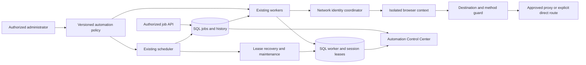

# Automation architecture

Adbot extends its existing SQL queue, worker, scheduler and outbound guard. There is one scheduler
implementation (`app.scheduler`), not a separate automation daemon. SQL remains authoritative;
Redis accelerates wakeups, enforces distributed request limits and aggregates egress heartbeats.

## Persistent state

Migration `a20d00000001` follows `f19c00000001`. It adds job priority, a single immutable dependency
reference and manual-release state. New tables are `automation_control` (singleton CAS policy),
`operational_events` (policy history, notifications and audit), `worker_heartbeats`, `selection_counters`,
`shared_proxy_health` and `network_assignments`. Existing content and User-Agent revisions stay intact.

The scheduler checks due schedules each second; supervision runs every 30 seconds; approved retention
cleanup runs hourly. Worker heartbeats are written every ten seconds and expire after 45 seconds;
scheduler heartbeats are renewed by supervision. Job leases use the existing operator duration,
90 seconds by default. Workers renew their job and identity leases together.

## Runtime configuration

Policy reads for queue decisions use committed SQL state. PostgreSQL control-row locks serialize
claims, capacity checks and schedule policy decisions. Browser routing strategy reads have a one-second
cache; bound identity remains pinned. API and worker processes watch committed User-Agent revisions
each second, with exponential error backoff up to 30 seconds and the existing five-second read-cache
fallback. Full documents are validated before use. Environment security limits remain authoritative.

## Security boundaries

Existing destination, DNS/IP, robots, method, rate, approval, token/time and encryption checks remain.
`X-AdBot-Automation` and `X-AdBot-Session` still identify browser automation. Fixed identities and fixed
egress cannot be relaxed through runtime policies. Global administrator controls intentionally affect
all workspaces; individual job actions and detailed job lists remain bound to the caller's workspace.

Each job gets an isolated browser process/context; browser pooling across workspaces is deliberately
absent. Normal completion, cancellation, timeout and handled crashes close resources; the Playwright
driver context and container init provide process cleanup. Abrupt host failure requires process/container
supervision and lease expiry. Arbitrary host-wide browser killing is not performed.

See [coverage](AUTOMATION_COVERAGE_MATRIX.md), [coordination](NETWORK_IDENTITY_COORDINATION.md),
[deployment](DEPLOYMENT.md), [verification](TEST_RESULTS.md) and the [final report](IMPLEMENTATION_REPORT.md).
