# Structured data extraction

## Scope and repository audit

Implemented on the local `main` branch of `SteveParadox/AdBot`, preserving pre-existing
uncommitted concurrency/audit work and unrelated local files. No public deployment,
credential change, commit or push was performed.

| Capability | Before | Implementation |
|---|---|---|
| Playwright loading, context isolation, JS rendering | Implemented | Reused unchanged browser ownership/egress boundaries |
| Page text/link actions and crawl frontier | Implemented | Existing visits, workflow actions and frontier reused |
| AI evidence and provider handoff | Implemented | Existing ModelClient, Groq-first configuration and approved fallback reused |
| Durable SQL jobs, scheduling, leases, recovery | Implemented | Existing queue/scheduler/worker extended |
| User-defined structured schemas | Missing | Validated immutable schema versions and field builder |
| Structured dataset persistence | Missing | Workspace-owned records, bounded revisions and run observations |
| Deduplication and meaningful changes | Needs integration | Identity/hash matching, revisions, change events and conservative missing confirmation |
| Structured JSON/CSV datasets | Missing | Worker-queued, bounded-memory, authenticated expiring exports |
| Dataset dashboard | Missing | Data Extraction screen with real APIs and downloads |

Before implementation, EXTRACT_TEXT/EXTRACT_LINKS returned workflow event details
and agents saved evidence; neither provided a versioned dataset lifecycle. Raw
page hashes already existed, but did not implement normalized record comparisons.

## Architecture and real execution path

```mermaid
flowchart LR
  Configure[Schema / dataset / schedule] --> Queue[Existing SQL jobs]
  Queue --> Worker[Existing worker]
  Worker --> Browser[Authorized isolated browser]
  Browser --> Capture[Bounded CSS / XPath / metadata capture]
  Capture --> Normalize[Pure normalization and validation]
  Capture --> AI[Optional Groq-first evidence enrichment]
  AI --> Normalize
  Normalize --> Persist[Leased transaction / identity deduplication]
  Persist --> Records[(Records / revisions / changes)]
  Records --> Dashboard[Dataset explorer]
  Records --> Export[Existing queue: export runner]
  Export --> Download[Authenticated expiring artifact]
```



`make_job` captures the selected dataset, immutable schema definition and options
in the job snapshot and creates an ExtractionRun. A dataset can be attached to a
website so later crawls, workflows and agent tasks automatically capture structured
records. An explicit extraction run can select a dataset without altering website
configuration. Extraction schedules attach their dataset to an existing Schedule
through a binding table; later website bindings cannot retarget those schedules.

`Runner.visit` invokes extraction after successful navigation/readiness and before
discovering links. Workflow selector waits, scrolling and extraction actions also
capture updated content. Agent post-action observations use the same subsystem.
There is no second crawler, browser service, scheduler, HTTP fetching bypass or
job queue. Page navigation, robots, redirects, method guards, proxies, identities,
domain leases, cancellation gates, deadlines and worker fencing remain in force.

Capture is a fixed program using the browser's CSS/XPath APIs. User expressions
are data arguments, never executable Python/JavaScript. Normalization and record
processing are pure Python functions that can also consume captured observations
or fixtures without owning a browser lifecycle.

## Schemas and templates

Supported field types: string, integer, decimal, currency amount, explicit boolean,
date, datetime, URL, list and object. Object/list structure is bounded rather than
an unrestricted recursive user program. Required/non-null fields, maximum lengths,
numeric bounds, allowed choices, date formats, Unicode/whitespace/entity cleanup,
currency-code case and explicit decimal separators are validated. Currency amounts
remain Decimal-derived JSON strings: no binary float conversion or invented
exchange rate occurs. Naive datetimes use the schema's explicit IANA timezone;
stored datetimes include a UTC offset. Dates are ISO or use an explicit format.

Five editable template seeds cover products, jobs, articles, public LocalBusiness
metadata and page monitoring. Built-ins are protected seeds: edit and save them as
reusable schema copies, then version or duplicate those copies. Templates are not
universal selectors. JSON-LD providers use different shapes/types; users must select
the correct type/path or edit CSS/XPath rules. For example, a NewsArticle site may
need `jsonld_type: "NewsArticle"` instead of the Article seed. A generic remote
label is stored as observed and never converted into country eligibility.

Schema version rows are immutable. Editing creates another row in the same schema
family with a database-enforced unique version. Records and revisions retain the
actual schema ID/name/version in provenance, so later edits do not rewrite history.
Dataset option/schema changes use expected_version compare-and-swap protection.

### Example CSS schema

```json
{
  "name": "Catalog products",
  "record_selector": ".product",
  "identity_fields": ["product_url"],
  "fields": {
    "name": {"type":"string","method":"css","selector":".name","required":true},
    "price": {"type":"currency","method":"css","selector":".price"},
    "product_url": {"type":"url","method":"css","selector":"a.product-url","attribute":"href","required":true}
  }
}
```

Methods are css, xpath, jsonld (dot path), meta (name/property), source_url,
page_title and ai. CSS/XPath fields are relative to the selected record container.
Metadata selectors read the page, and JSON-LD fields use the selected typed object.
Mixed metadata/DOM fields can deliberately use page-level DOM fallbacks. Use
relative XPath for repeated containers; explicitly global XPath remains page-global.
Field transformations are allowlisted (`lower`, `upper`, `currency_code`).

## Optional AI enrichment and evidence

Deterministic extraction works with AI disabled. Fields explicitly using method
`ai`, or missing fields with dataset `ai_fallback: true`, use the existing provider
configuration. In this workspace Groq remains primary and Qwen is the configured
fallback; this feature does not change provider credentials or preference.

Natural-language `ai_instructions` accompanies the selected field schema and
bounded observed content. Each candidate must include an exact quote from its
record's observed text; the value must occur verbatim in that quote. Unsupported
values are rejected, extra fields ignored, and accepted quotes saved in provenance.
Evidence is limited to 8,000 characters per record. Model usage, calls and latency
are persisted with a durable token reservation before the network call. Attached
agent enrichment also shares the existing agent model client, fallback state and
max_tokens accounting in the same transaction; it is not an extra token allowance. Model
JSON output then passes the same deterministic validator as all other records.

This is conservative field enrichment, not unconstrained AI crawling or entity
discovery. Repeated records still need deterministic containers or metadata roots.
Exact quoting prevents fabricated unseen values; it does not certify that the
source website is truthful or remove the need to review semantic mappings.
Website text cannot authorize another domain, execute tools or change configuration.

## Deduplication, revisions and monitoring

Identity uses configured composite fields (including canonical URL/identifier
fields when selected). Without identity_fields, normalized content plus source URL
is an exact-content key; configure stable identity fields when updates should remain
the same entity. Missing identity fields fail validation, rather than merging
unrelated null identities. A unique dataset/identity constraint is the final guard.

An unchanged hash updates last-seen ownership without another revision. Policies
support skip, update, revision, or review of changed candidates. Both update and
revision preserve bounded historical revisions; update does not erase audit history.
Fuzzy matching examines at most 20 existing candidates and 40 bounded tokens per
signature. It only flags possible duplicates and never automatically merges titles.
It is intentionally conservative, not a global fuzzy-search index.

Changes include new, updated, price increase/decrease, possible duplicate,
review-required, missing, removed and rediscovered. Updated events include changed
fields, previous/current normalized hashes, before/after values and a summary.
Volatile fields can be excluded with ignored_change_fields. Schema provenance and
extraction timestamps do not enter the content hash by default.

Missing confirmation is **off by default**. With confirm_missing enabled, at least
two complete successful confirmations are required. Failed/cancelled jobs, invalid
records, HTTP errors, blocked/failed/pending frontier entries, page-limit exhaustion,
record/transfer/scroll/pagination truncation and workflow/agent observations cannot
confirm removal. Missing and removed records remain inspectable rather than being
immediately deleted. Operators must define a trustworthy collection scope; the
software cannot prove that an arbitrary website exposes its entire catalog.

## Database changes and transaction safety

Migration `b31e00000001` follows `a20d00000001` and adds:

- extraction_schemas: workspace/family/version uniqueness and immutable definitions.
- datasets: workspace/source/schema/options/version.
- extraction_runs: one row per existing automation job, counts, usage and finalization.
- extraction_schedule_bindings: existing Schedule to dataset association.
- extracted_records: unique dataset/identity, normalized/original values, provenance,
  first/last seen, status, missing count and revision number.
- record_revisions: unique record/revision with bounded retained history.
- extraction_observations: unique job/fingerprint for recovery/idempotency.
- extraction_issues: bounded per-run validation/extraction diagnostics.
- data_changes: indexed machine-readable dataset events.
- dataset_exports: existing job to expiring artifact/progress metadata.

Foreign keys cascade owned subordinate data and restrict referenced schemas. Source
job deletion clears record last-job references rather than deleting records. Owner,
dataset, status and chronological query paths are indexed. SQLite/WAL development
and PostgreSQL are supported. No production database was migrated during this task;
migration tests used temporary databases and an isolated PostgreSQL container.

Each page's observations, records, revisions, changes and counters commit together.
Writes check job token/expiry; same-dataset writes serialize on the dataset row
(a first conditional write also serializes SQLite). Creation/deletion locks protect
dataset lifecycle on PostgreSQL. Previously committed pages survive subsequent
errors and worker recovery. This is at-least-once observation with idempotent
persistence, not exactly-once external HTTP or model billing.

Storage is bounded by dataset record count, per-record revisions, field/object/page
sizes, per-run issue count, change-event ceilings and retention. The existing
scheduler cleanup expires records/changes/issues/artifacts. Expired orphan export files are removed after the configured export TTL; active
export filenames are retained during pauses/recovery.

## Export behavior

Every export is a job in the existing queue and runs without launching a browser.
JSON contains schema/version, records, provenance and optional revisions. CSV is
UTF-8, uses Python csv.writer, explicit columns/order, dotted nested paths, JSON
for arrays/objects and empty text for null. Spreadsheet formula prefixes, including
whitespace/BOM-prefixed formulas, receive a leading apostrophe.

Exports read 100-record batches (one record per batch when revisions are requested), release each SQL session before writing, enforce
an operator byte cap, check cancellation/leases and pause between batches, and
publish row/byte progress. If content changes during export, the file is rejected
and removed; retry obtains a consistent dataset version rather than silently mixing
versions. Filenames are generated UUIDs and downloads check workspace ownership,
job completion, path containment and expiry. Partial failed exports are removed.

Environment defaults (also in .env.example):

```dotenv
ADBOT_EXTRACTION_MAX_EXPORT_BYTES=52428800
ADBOT_EXTRACTION_EXPORT_TTL_SECONDS=86400
```

Dataset defaults: 100 records/page (maximum 500), 10,000 records total (maximum
100,000), 20 revisions/record (maximum 100), 30-day retention, zero extra scrolls,
AI fallback off, missing confirmation off. Schema limits are 50 fields, depth 8,
500-character selectors and 64 KiB record data; browser transfer is capped at about
1 MiB per capture. Extra scrolling is capped at 10 iterations with bounded explicit
height-change waits; ready_selector waits for visible content. No arbitrary regex
transforms, Python code or JavaScript programs are accepted from users.

## API and dashboard

All routes below require the existing Bearer workspace key. Cross-workspace
resources return 404. Validation failures use 422; inactive/conflicting/stale or
not-ready resources use 409. Existing API throttling still applies.

| Endpoint under /api/extraction | Purpose |
|---|---|
| GET /templates | Built-in editable schema seeds |
| POST /schemas/validate | Validate definition/limits |
| GET, POST /schemas | List/create schemas |
| POST /schemas/{id}/versions | Immutable next version |
| POST /schemas/{id}/active?active=false | Activate/deactivate a version |
| GET, POST /datasets | List/create datasets |
| PATCH /datasets/{id} | Update name/schema/options with expected_version |
| DELETE /datasets/{id} | Delete owned data/exports/schedules after active jobs finish |
| POST /datasets/{id}/bind | Attach future website automation to dataset |
| POST /datasets/{id}/run | Queue crawl/extraction; Idempotency-Key supported |
| POST /datasets/{id}/schedules | Create existing Schedule with fixed dataset association |
| GET /datasets/{id}/records | Paginated, text-searchable, state-filtered records |
| GET /datasets/{id}/records/{record}/revisions | Paginated immutable history |
| GET /datasets/{id}/changes | Paginated change events |
| GET /datasets/{id}/runs | Counts/status/partial runs/retries/model usage |
| GET /runs/{job}/issues | Paginated diagnostics |
| POST, GET /datasets/{id}/exports | Queue exports/list progress/history |
| GET /exports/{job}/download | Authenticated ready artifact |

The Data Extraction dashboard provides template selection, field/type/method
builder, advanced schema JSON, validation, duplicate/version/activation controls,
dataset options/editing, manual runs, fixed schedules, website attachment, paginated
records/source/history/change/run diagnostics and export downloads. It uses actual
backend APIs and no simulated records. Schedule management remains in Schedules;
job pause/resume/cancel remains in the existing Jobs/Automation controls.

## Usage

1. Install the existing project dependencies and Playwright browsers as usual.
2. From backend run `..\.venv\Scripts\python.exe -m alembic upgrade head` on Windows
   (use the existing deployment migration process in production).
3. Start/restart API, worker and scheduler with the normal project launcher after
   reviewing the change. This task did not restart the user's running services.
4. Add an authorized target in Websites, with explicit domains, crawl limits and
   robots compliance. Keep existing security controls enabled.
5. Open Data Extraction. Choose/edit a template, set record selectors and stable
   identity fields, validate and create a schema.
6. Create a dataset with that website/schema. For delayed catalogs, options can be
   `{"ready_selector":".product","pagination_selector":"a.next"}`. Navigation
   remains subject to website max_pages/max_depth/time limits.
7. Run extraction. Inspect records, errors and source evidence. For ordinary-language
   enrichment set ai_instructions and explicit ai methods or ai_fallback; Groq-first
   provider configuration remains the operator's existing configuration.
8. Create a fixed cron schedule (dashboard uses UTC), or attach to website automation
   for future workflows/agents. Review intentional scope before enabling removals.
9. Queue JSON/CSV exports and download when completed. Artifacts expire; queue a new
   export if expired or if concurrent content changes made the export fail.

## Benchmarks

Run `.venv\Scripts\python.exe scripts/benchmark_extraction.py` from root. It uses
an isolated temporary SQLite database and no external traffic. Raw results are in
[BENCHMARK.json](BENCHMARK.json). At 1,000 records: normalization 0.693s,
persistence 7.878s (126.93 records/s), JSON export
1.266s / 555,400 bytes, CSV export
1.158s / 52,796 bytes. Total 11.182s,
process CPU 7.547s, peak traced Python allocations
3,619,315 bytes and database size 2,170,880 bytes; zero errors.
This final representative measurement is not a production capacity guarantee or
RSS measurement. No equivalent structured pipeline existed before this change,
so a like-for-like before/after extraction throughput comparison is unavailable;
no speedup claim is made. Browser rendering/network time is excluded.

## Verification, defects corrected and remaining limits

Executed results and final acceptance status are recorded in [VERIFICATION.md](VERIFICATION.md).
During implementation, tests/review found and corrected: mixed JSON-LD/DOM roots,
HTTP-error false-removal risk, unbounded capture transfer/evidence, unsafe partial
scroll/pagination completion, export pause/cancellation and dataset lifecycle races,
unbounded change history, dataset stale edits, malformed schema editor crashes,
CSV object loss, formula prefixes, metadata parser limits and per-record AI evidence.
One failure-path test initially counted artifacts from earlier tests; its artifact
directory was isolated instead of deleting unrelated files. The first two dashboard
test attempts used an exact label-text selector incompatible with a nested select;
the accessible combobox selector fixed the test without changing user semantics.

Existing outbound concurrency audit release gates still apply: provider-wide
account quotas and some synchronous SQL hot paths are not solved by this feature.
Keep deployment limits conservative and perform a representative soak/load test.
XPath/JSON-LD breadth/depth and page-transfer limits can intentionally produce
partial runs. Full browser-process memory and hostile-page CPU need OS/container
limits; application timeouts are not an OS sandbox. No CAPTCHA/authentication or
rate-limit bypass, stealth scraping or advertising interaction was added.

Source content is not automatically certified public/non-sensitive. Use authorized
schemas/targets, avoid collecting private contact information, and set appropriate
retention. Source evidence is bounded; raw full-page bodies are not archived.

## Components and implementation references

New subsystem: [schemas.py](../../backend/app/extraction/schemas.py),
[engine.py](../../backend/app/extraction/engine.py),
[templates.py](../../backend/app/extraction/templates.py),
[service.py](../../backend/app/extraction/service.py),
[persistence.py](../../backend/app/extraction/persistence.py),
[exporter.py](../../backend/app/extraction/exporter.py),
[api.py](../../backend/app/extraction/api.py).
Integration changes: db.py, config.py, schemas.py, jobs.py, worker.py, browser.py,
agent/runner.py, automation.py and main.py. New migration:
[b31e00000001](../../backend/alembic/versions/b31e00000001_structured_extraction.py).
Dashboard: DataExtraction.tsx, extractionSchema.ts, App.tsx, api.ts, style.css.
Tests: backend/tests/test_extraction.py, frontend/src/DataExtraction.test.tsx,
frontend/e2e/extraction.spec.ts. Benchmark: scripts/benchmark_extraction.py.
The existing e2e runner now accepts an optional test-file argument; its default
behavior remains the full journey suite. No package dependencies were added.

Library research used primary documentation: [Playwright CSS/XPath locators](https://playwright.dev/python/docs/locators),
[locator evaluation](https://playwright.dev/python/docs/api/class-locator),
[Python csv](https://docs.python.org/3/library/csv.html),
[Decimal](https://docs.python.org/3/library/decimal.html) and
[datetime](https://docs.python.org/3/library/datetime.html). Existing Playwright,
Pydantic, SQLAlchemy/Alembic, stdlib CSV/JSON/Decimal and bounded difflib matching
were preferred over another parser/export/queue framework.
