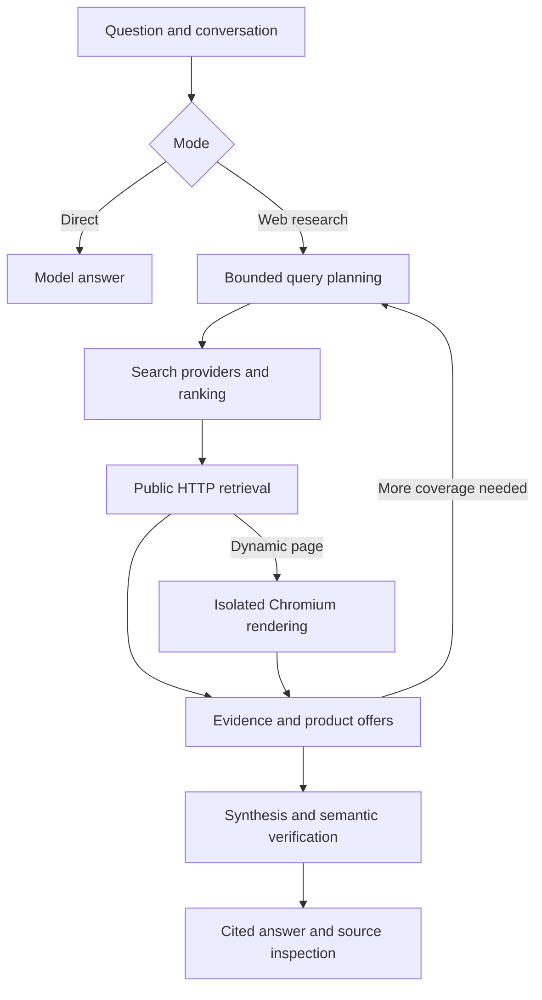
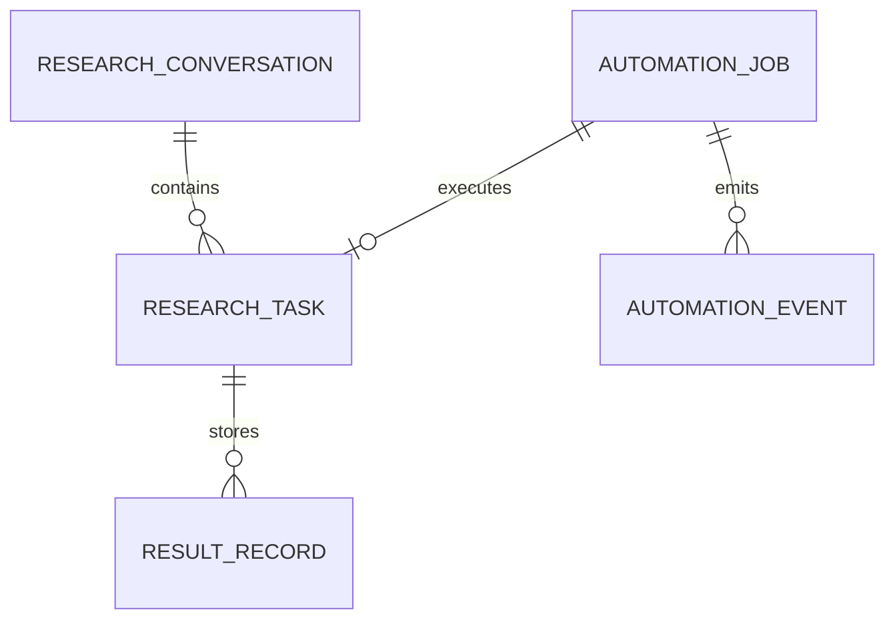

# Research architecture

The authenticated API stores a durable job in the shared SQL queue. The research task keeps its question, resolved mode, budget and result. A research job has no website foreign key. Every other job retains its required website reference. The worker uses existing capacity limits, leases, pause and cancel controls, recovery and Redis wakeups. Events, usage reservations and result persistence use the worker lease to fence stale writes. Search and model attempts, candidate pages, browser attempts and charged tokens carry forward when a worker lease expires.

The model client handles planning for specialized modes, candidate claims and verification. Search strings come from the user's question, conversational context and bounded planning. Source data enters synthesis and verification as untrusted evidence. The model sends no network requests and has no browser tools. Each accepted claim is tied to exact stored evidence IDs, and citation URLs are rendered from that mapping.

The result stores normalized search hits, source metadata, evidence locations and hashes, claim mappings, structured offers and execution metrics in a bounded task-scoped JSON payload. Raw page bodies and browser profiles are ephemeral. Conversation messages are ordered research tasks. Deleting an inactive conversation removes its jobs, persisted results and progress history. The existing scheduled retention job removes expired terminal jobs and empty conversations. Worker caches are bounded, in memory and tenant-keyed.

Research networking starts with an independent public-source policy. An egress proxy resolves a hostname and opens a socket to a validated public IP. Each redirect is validated afresh. Source fetches have no credentials, cookies or environment proxy inheritance. Chromium rendering is optional. It uses a new context per source, accepts only the selected document and a bounded set of same-origin read-only resources, and uses a local closed proxy route for traffic outside those handlers. Private SearXNG services are a separate operator-only configuration.
